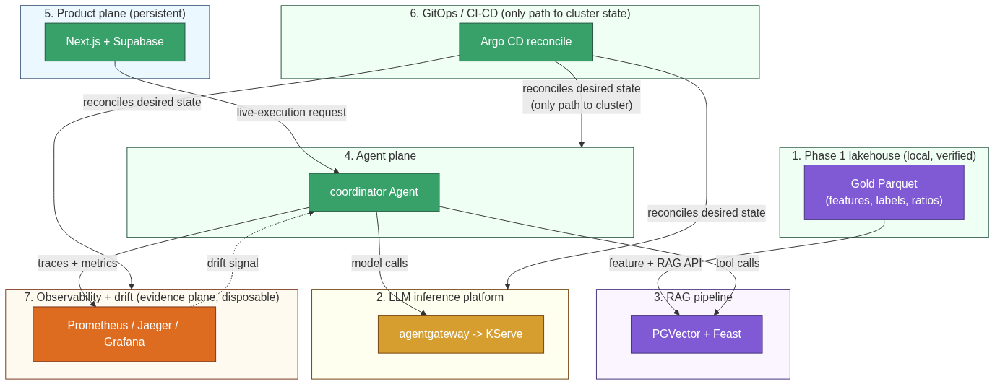
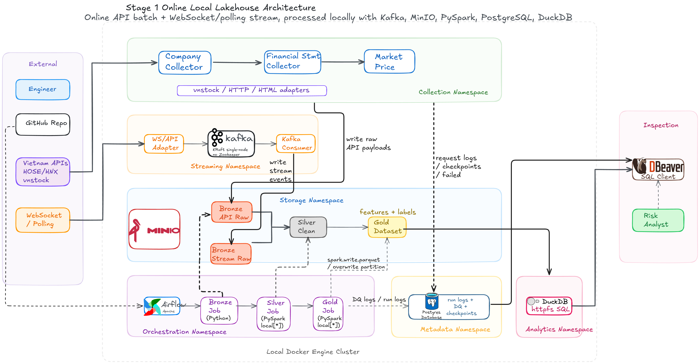

# Financial Distress Data + AI Engineering Platform

A local-first financial-distress data lakehouse for Vietnamese listed companies, extended by a persistent analyst product and an additive, on-demand LLM and agent platform with explicitly configured runtime endpoints.

## 📚 Table of Contents

1. [🏦 Business Domain](#-business-domain)
2. [📝 System Overview](#-system-overview)
3. [🏗️ Architecture](#️-architecture)
4. [📁 Repository Structure](#-repository-structure)
5. [🗂️ Coursework Documentation](#️-coursework-documentation)
6. [🚀 Quickstart](#-quickstart)
7. [📌 Project Status](#-project-status)

## 🏦 Business Domain

The platform is a **local-first financial-distress data lakehouse** for Vietnamese listed companies. It collects quarterly financial statements, daily market prices, and supporting reference data, then produces curated Bronze/Silver/Gold tables, distress labels (Altman Z''-Score inspired), and audit-ready evidence that downstream analysts and ML engineers can trust.

Primary users:

- **Data engineer** — owns the Airflow DAGs, Kafka topics, PySpark transforms, MinIO layout, and PostgreSQL metadata.
- **ML engineer** — consumes Gold features and `obt_company_quarter_risk` to train, score, and monitor financial-distress models (platform).
- **Analyst / reviewer** — opens DBeaver or DuckDB against the local lakehouse to validate row counts, SCD2 history, lineage, and data contracts, or the product web app for a live authenticated view.

Why it matters: a missed early warning on a stressed issuer costs downstream capital and credit decisions. The platform compresses that feedback loop by putting curated, quality-checked, lineage-tracked data one query away from the consumer.

## 📝 System Overview

- **Local lakehouse:** the [coursework spec](docs/mini_coursework.md) and [Docker Compose](docker-compose.yml) own the local medallion pipeline and its runtime. Cloud setup is not a prerequisite.
- **Persistent product:** the [web workspace](apps/web/README.md) and [Supabase migrations](supabase/migrations/) own the analyst experience and its data boundary. Live runtime availability is separate from product availability.
- **LLM, RAG, agents and MCP:** see the [RAG pipeline](src/llm/rag_pipeline.py), [agent runtime](src/agents/runtime.py), and [platform runtime setup](docs/operator-runbook.md#phase-2-runtime-setup). A live answer must come from the configured services, not coursework captures.
- **Delivery and evidence:** [source CI](.github/workflows/phase2-ci.yaml) hands off signed images. The [external deployment owner](docs/architecture/repository-map.md#separate-deployment-repository) decides where and how to run them; the coursework diagrams show one historical topology.

## 🏗️ Architecture

Coursework system diagram — a reference topology, not a current deployment map (source: [`docs/architecture/system-overview.mmd`](docs/architecture/system-overview.mmd), regeneration command in [`docs/system-architecture.md`](docs/system-architecture.md)):



Every diagram node is a **deployable unit** — Airflow, Kafka, Flink (opt-in), Spark (PySpark local mode), MinIO, and PostgreSQL each run as their own process or container, never a library or SDK. Each subsystem also has its own small Mermaid diagram, embedded in the narrative doc that proves it — see [`docs/system-architecture.md`](docs/system-architecture.md) for the full diagram index (5-class color legend: edge/service/store/model/result) and links into every owning doc. The platform-mandated deployment diagram required by `docs/mini_coursework.md` stays at its spec-pinned path:



## 📁 Repository Structure

```txt
├── dags/                  - Airflow DAGs, including additive platform workflows
├── src/                   - Python source code
│   ├── collectors/        - Fixture-backed source adapters and collectors
│   ├── streaming/         - Kafka event contracts, micro-batch logic, Flink opt-in client
│   ├── transforms/        - Bronze/Silver/Gold transform logic
│   ├── quality/           - Data quality checks and DQ runner
│   ├── metadata/          - PostgreSQL metadata writers and schema registry
│   ├── catalog/           - DuckDB catalog and validation helpers
│   ├── io/                - MinIO and local IO helpers
│   ├── jobs/               - Runtime evidence job wrappers
│   ├── ml/                - ML contracts and adapters
│   ├── drift/             - Drift detection and simulation
│   ├── llm/               - LLM contracts, RAG pipeline and inference guards
│   └── agents/            - Coordinator, feature and drift agent orchestration
├── apps/                  - Web product and feature/drift API and MCP services
├── packages/              - Shared TypeScript contracts and UI helpers
├── supabase/              - Product migrations, RLS and outbox schema
├── feature_repo/          - Feast structured/RAG feature definitions
├── notebooks/             - Agent/MCP demonstration notebooks (LLM evidence track)
├── configs/               - Collector, Spark, source, drift, and DQ config files
├── sql/                   - PostgreSQL metadata DDL and DuckDB SQL views
├── tests/                 - PyTest unit, contract, and runtime tests; tests/platform/ covers platform
├── docs/                  - Specs, narrative submission docs, architecture, evidence notes
│   ├── submission/         - Reviewer-facing narrative docs (LLM track, mini-coursework, ML deferred)
│   ├── architecture/       - Subsystem + composed Mermaid diagram sources
│   ├── pngs/                - Reviewer screenshot/diagram pool (manifest-tracked)
│   └── platform/evidence/ - Coursework evidence and product captures
├── images/                - Spec-mandated architecture diagrams
├── infra/                 - Container build/bootstrap assets (airflow/, flink/, kafka/)
├── scripts/               - Local E2E, DQ-failure, evidence-audit, and doc-gate runners
├── plans/                 - Implementation plans, phase files, and reports
├── docker-compose.yml     - Local platform services (Postgres, Kafka, MinIO, Airflow, Flink opt-in)
├── pyproject.toml         - Python package and tooling config
└── README.md              - This file
```

See the [repository ownership map](docs/architecture/repository-map.md) for the boundary between local setup, source delivery, external deployment, and coursework evidence.

## 🗂️ Coursework Documentation

Three reviewer index tables, each row linking to a full narrative doc with real code quotes, image proofs, and honest limitations (skeleton fixed in [`docs/docs-style-contract.md`](docs/docs-style-contract.md)):

**LLM track — coursework reviewer index at [`rubric-final-coursework-(final-llm)/README.md`](<docs/submission/rubric-final-coursework-(final-llm)/README.md>):**

| Area | Doc |
|---|---|
| LLM inference platform | [`llm_inference_platform.md`](<docs/submission/rubric-final-coursework-(final-llm)/llm_inference_platform.md>) |
| Global model config | [`global_model_config.md`](<docs/submission/rubric-final-coursework-(final-llm)/global_model_config.md>) |
| Agent registry | [`agent_registry.md`](<docs/submission/rubric-final-coursework-(final-llm)/agent_registry.md>) |
| RAG | [`rag.md`](<docs/submission/rubric-final-coursework-(final-llm)/rag.md>) |
| Web API — feature pull | [`web_api_user_data.md`](<docs/submission/rubric-final-coursework-(final-llm)/web_api_user_data.md>) |
| Web API — drift detection | [`web_api_drift_detection.md`](<docs/submission/rubric-final-coursework-(final-llm)/web_api_drift_detection.md>) |
| Agent understanding | [`agent_understanding.md`](<docs/submission/rubric-final-coursework-(final-llm)/agent_understanding.md>) |
| Coordinator agent | [`coordinator_agent.md`](<docs/submission/rubric-final-coursework-(final-llm)/coordinator_agent.md>) |
| Agent warm-up | [`agent_warm_up.md`](<docs/submission/rubric-final-coursework-(final-llm)/agent_warm_up.md>) |
| CI/CD | [`ci_cd.md`](<docs/submission/rubric-final-coursework-(final-llm)/ci_cd.md>) |
| Routing & gateway | [`routing_gateway.md`](<docs/submission/rubric-final-coursework-(final-llm)/routing_gateway.md>) |
| IaC | [`iac.md`](<docs/submission/rubric-final-coursework-(final-llm)/iac.md>) |
| Observability | [`observability.md`](<docs/submission/rubric-final-coursework-(final-llm)/observability.md>) |
| A/B testing | [`ab_testing.md`](<docs/submission/rubric-final-coursework-(final-llm)/ab_testing.md>) |
| Security | [`security.md`](<docs/submission/rubric-final-coursework-(final-llm)/security.md>) |
| Validation & verification | [`validation_verification.md`](<docs/submission/rubric-final-coursework-(final-llm)/validation_verification.md>) |
| Improve the data generator | [`improve_data_generator.md`](<docs/submission/rubric-final-coursework-(final-llm)/improve_data_generator.md>) |
| Repository design | [`repository_design.md`](<docs/submission/rubric-final-coursework-(final-llm)/repository_design.md>) |
| Low-level design | [`low_level_design.md`](<docs/submission/rubric-final-coursework-(final-llm)/low_level_design.md>) |
| Novel ideas | [`novel_ideas.md`](<docs/submission/rubric-final-coursework-(final-llm)/novel_ideas.md>) |
| Cost | [`cost.md`](<docs/submission/rubric-final-coursework-(final-llm)/cost.md>) |

**Mini-coursework (platform) — full index at [`rubric-(mini-coursework)/README.md`](<docs/submission/rubric-(mini-coursework)/README.md>):**

| Area | Doc |
|---|---|
| README business domain | [`readme_business_domain.md`](<docs/submission/rubric-(mini-coursework)/readme_business_domain.md>) |
| Engineering fundamentals | [`engineering_fundamentals.md`](<docs/submission/rubric-(mini-coursework)/engineering_fundamentals.md>) |
| Data generator | [`data_generator.md`](<docs/submission/rubric-(mini-coursework)/data_generator.md>) |
| Processing jobs | [`processing_jobs.md`](<docs/submission/rubric-(mini-coursework)/processing_jobs.md>) |
| Data storage | [`data_storage.md`](<docs/submission/rubric-(mini-coursework)/data_storage.md>) |
| Data pipeline orchestration | [`data_pipeline_orchestration.md`](<docs/submission/rubric-(mini-coursework)/data_pipeline_orchestration.md>) |
| Data governance | [`data_governance.md`](<docs/submission/rubric-(mini-coursework)/data_governance.md>) |
| Schema design | [`schema_design.md`](<docs/submission/rubric-(mini-coursework)/schema_design.md>) |
| Novel ideas | [`novel_ideas.md`](<docs/submission/rubric-(mini-coursework)/novel_ideas.md>) |

**ML track — deferred by accepted decision, full reasoning at [`ml-track-deferred.md`](docs/submission/ml-track-deferred.md):** 18 sections, 57 rows, 100 points, every row `design_only` with a concrete reason and a pointer to the nearest LLM-track equivalent where one exists.

## 🚀 Quickstart

Start with [local setup](docs/operator-runbook.md#local-setup) and the [naming convention](docs/operator-runbook.md#naming-convention). For the platform, see the [web workspace](apps/web/README.md) and [external deployment handoff](docs/operator-runbook.md#external-deployment-handoff).

## 📌 Project Status

- **Current source contract:** the lakehouse stays local-first; platform endpoints and any deployment target are chosen explicitly. See [architecture boundaries](docs/system-architecture.md#architecture-boundaries) and the [source verification workflow](.github/workflows/ci.yml).
- **Historical coursework evidence:** the [submission reviewer index](docs/submission/README.md) and [historical evidence route](docs/operator-runbook.md#historical-phase-2-evidence) document the GKE captures and the two-repository audit. Neither is a live health or freeze claim for this checkout.
