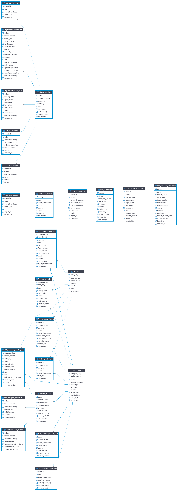

# Operator Runbook

Use this guide for local Phase 1 setup, Phase 2 configuration and its external
deployment handoff. Coursework captures are evidence for their recorded runs,
not instructions to recreate a live deployment.

## Table of Contents

1. [Naming Convention](#naming-convention)
2. [Runtime Evidence Snapshot — Phase 1](#runtime-evidence-snapshot--phase-1)
3. [Schema Evidence](#schema-evidence)
4. [API Surface](#api-surface)
5. [Local Setup](#local-setup)
6. [Running in Docker](#running-in-docker)
7. [Phase 2 Runtime Setup](#phase-2-runtime-setup)
8. [External Deployment Handoff](#external-deployment-handoff)
9. [Historical Phase 2 Evidence](#historical-phase-2-evidence)
10. [Service URLs](#service-urls)
11. [Run Stage 1 Evidence](#run-stage-1-evidence)
12. [Validation Commands](#validation-commands)
13. [Useful Inspection Queries](#useful-inspection-queries)
14. [Stop Services](#stop-services)

## Naming Convention

The Gold layer uses a single naming rule, enforced by
`tests/test_naming_convention.py`. The rule covers both the
DuckDB-side view names and the MinIO-side storage paths so the
two never drift apart.

### DuckDB Views

Every view defined in `sql/duckdb_create_views.sql` matches
`gold_{dim_|fact_|obt_|feat_}*`:

| Layer prefix | Meaning | Examples |
| --- | --- | --- |
| `gold_dim_` | Conformed dimension tables | `gold_dim_company`, `gold_dim_date` |
| `gold_fact_` | Event or measurement facts | `gold_fact_financial_statement`, `gold_fact_market_price`, `gold_fact_market_alert`, `gold_fact_news_sentiment` |
| `gold_obt_` | One-big-table denormalized joins | `gold_obt_company_quarter_risk` |
| `gold_feat_` | Model-ready feature tables | `gold_feat_company_financial_4q`, `gold_feat_company_market_30d`, `gold_feat_company_news_30d`, `gold_feat_company_unified` |

### MinIO Storage Paths

Gold writes in `src/jobs/stage1_spark_lakehouse_job.py` go to one of
the allowed layer folders under the `gold/` prefix:

```
s3a://financial-distress-lake/gold/dim_*/
s3a://financial-distress-lake/gold/fact_*/
s3a://financial-distress-lake/gold/obt_*/
s3a://financial-distress-lake/gold/feat_*/
s3a://financial-distress-lake/gold/distress_labels/
```

`distress_labels` is the only Gold folder that does not use the
`dim_/fact_/obt_/feat_` family because it carries the label targets
that the Phase 2 ML training reads; it is intentionally a single
top-level folder so the labels are easy to discover and audit.

### Bronze and Silver

Bronze and Silver storage paths do not enforce a per-table prefix
inside the layer folder — the dataset name is the only segment:

```
s3a://financial-distress-lake/bronze/{dataset}/data.parquet
s3a://financial-distress-lake/silver/{dataset}/
```

This keeps the raw ingest and dedup layers flexible enough to absorb
new source adapters without forcing a schema rename on every
addition.

## Runtime Evidence Snapshot — Phase 1

The checked-in Stage 1 evidence proves the local pipeline has run end to end.
The latest committed evidence package reports `status: pass` in
`docs/evidence/stage1_runtime_audit_summary.json`.

| Evidence area | Current proof |
|---|---|
| Airflow pipeline | `stage1_real_e2e_pipeline` finished successfully in `docs/evidence/stage1_real_airflow_dag_test.txt` |
| Kafka streaming | Offsets exist for `financial.price_events`, `financial.news_events`, and `financial.alert_events` |
| MinIO lakehouse | 436 objects across Bronze, Silver, Gold, and `evidence/stage1/` prefixes |
| PostgreSQL metadata | `pipeline_run_log`, `data_quality_result`, `dataset_freshness`, `backfill_request`, `source_request_log`, and `collector_checkpoint` exported in `docs/evidence/stage1_real_postgres_summary.json` |
| DuckDB validation | Gold row counts, duplicate checks, distress-label distribution, and PIT leakage checks exported in `docs/evidence/stage1_real_duckdb_validation.json` |
| DQ failure handling | Critical DQ failure probe confirms failure is persisted before halt |

Key DuckDB metrics from the checked-in evidence:

| Metric | Value |
|---|---:|
| `total_financial_statement_rows` | 16 |
| `total_dim_company_rows` | 2 |
| `total_dim_date_rows` | 732 |
| `total_market_feature_rows` | 12 |
| `total_news_sentiment_rows` | 2 |
| `future_feature_leakage_rows` | 0 |

## Schema Evidence

The local schema follows a Medallion design: raw Bronze-style tables, Silver
staging tables, Gold dimensions/facts, distress labels, OBT, and feature tables.



DBeaver evidence can be reproduced by connecting to a local DuckDB file named
`warehouse.db` and opening the `schema_evidence` schema. `warehouse.db` is a
local generated artifact and is intentionally ignored by Git; regenerate it from
the local pipeline when needed. See `docs/submission/rubric-(mini-coursework)/schema_design.md`
for the narrative naming/SCD2/feature-contract proof.

## API Surface

Phase 1 is a local data pipeline, not a REST service. For Phase 2, start at
the [web workspace](../apps/web/README.md), [feature MCP](../apps/feature-mcp/),
and [drift MCP](../apps/drift-mcp/) source boundaries.

## Local Setup

Create and activate the repository-local Python environment, then use
[requirements.txt](../requirements.txt) and the [package extras](../pyproject.toml)
for dependencies.

```bash
python -m venv .venv
. .venv/bin/activate
python -m pip install -r requirements.txt
python -m pip install -e ".[dev,runtime]"
```

Create local environment config.

```bash
cp .env.example .env
```

Continue with [Docker Compose](#running-in-docker).

## Running in Docker

Start the local data platform from [Docker Compose](../docker-compose.yml).
No provider account is needed for Phase 1; Flink stays disabled by default.

```bash
docker compose up -d
```

Check service status.

```bash
docker compose ps
.venv/bin/python scripts/check_stage1_services.py
```

Opt in to Apache Flink (jobmanager + taskmanager, profile `flink`):

```bash
ENABLE_FLINK=1 docker compose --profile flink up -d
```

DAG 04 (`dags/dag_04_stream_market_events_to_kafka.py`) automatically dispatches to the Flink REST endpoint when `ENABLE_FLINK=1`; otherwise it keeps the original `MicroBatchConsumer` smoke path so the default stack stays light.

Create Kafka topics manually if needed.

```bash
docker compose exec kafka bash /opt/financial-distress-init/kafka_init_topics.sh
```

## Phase 2 Runtime Setup

Use the [web workspace](../apps/web/README.md) for local product setup. For
cloud-independent source checks, use the [Phase 2 quality gate](../scripts/run_phase2_quality_gates.py)
without an external checkout.
The preflight is not the full Phase 2 suite. Run `python -m pytest tests/phase2`
in the Phase 2 environment. Run web typecheck, lint and fixture browser
checks as listed in the [web workspace](../apps/web/README.md).

Configure only the interfaces each service uses. For HTTP connections, supply
explicit, absolute `http://` or `https://` URLs that the caller can reach.
Loopback is only appropriate when the endpoint is in the caller's network
namespace. Do not infer live addresses from the coursework cluster.
Use HTTPS for live bearer-authenticated endpoints. The application accepts
cleartext bearer transmission only on loopback for local testing. Do not send
sensitive data over unencrypted connections between live services.

| Runtime boundary | Setup and executable owner |
|---|---|
| Product data and assistant | See [Supabase client setup](../apps/web/src/lib/server/supabase.ts), [server-only inference configuration](../apps/web/src/lib/server/inference-config.ts) and the [assistant route](../apps/web/src/app/api/assistant/stream/route.ts) for the coordinator endpoint and token. Use fixture mode only for local development or tests, not live verification. |
| Live agent registry | Enable [live registry reads](../apps/web/src/lib/data/supabase-adapter.ts) with `DISTRESSLENS_LIVE_PLANE=1`. Set `DISTRESSLENS_AGENT_REGISTRY_URL` to the full deployed `/v1/agents` URL, including any routing prefix. For the [bundled server](../src/agents/registry.py), provide the JSON registry at `AGENT_REGISTRY_PATH` (default `/registry/registry.json`). Supply `DISTRESSLENS_SOURCE_SHA` for the deployed source. Supply `DISTRESSLENS_GITOPS_SHA` only if a GitOps configuration commit applies; otherwise leave it unset. Never invent revisions or copy them from coursework receipts. |
| Specialist agents and coordinator | Set `MODEL_BASE_URL` to the OpenAI-compatible base, `FEATURE_MCP_URL` and `DRIFT_MCP_URL` to full MCP endpoints, and `FEATURE_AGENT_URL` and `DRIFT_AGENT_URL` to specialist service bases where each is needed. The [agent runtime](../src/agents/runtime.py) owns the per-role endpoint, token and readiness settings. |
| Feature MCP and stores | Set `FEATURE_API_BASE_URL` for the [MCP client](../apps/feature-mcp/app/mcp_server.py). The deployment owner supplies a pre-applied Feast repository via `FEAST_REPO_PATH`; its selected profile configures the actual online store and is used for readiness and reads. Set `RAG_DATABASE_URL` or explicit Postgres settings as applicable; see the [feature API](../apps/feature-mcp/app/main.py). |
| Drift MCP | Set `DRIFT_API_BASE_URL` to use an HTTP API, including on loopback. Leave it unset only when the local in-process implementation is intended. See the [drift MCP entrypoint](../apps/drift-mcp/app/mcp_server.py) for transport and allowed-host configuration. |

For coordinator chat, configure the full `/v1/run` URL as
`DISTRESSLENS_COORDINATOR_URL` and provide `DISTRESSLENS_COORDINATOR_DRIFT_SCENARIO`
in the format consumed by the [assistant route](../apps/web/src/app/api/assistant/stream/route.ts)
and [drift schema](../apps/drift-mcp/app/main.py). For a path-prefixed MCP route,
configure `FEATURE_MCP_HEALTH_URL` or `DRIFT_MCP_HEALTH_URL` if the default
origin-root `/mcp-readyz` is not the right route. MCP readiness verifies its
configured business API; REST `/readyz` for Feature API checks its stores.

Glossary-only inference requires `DISTRESSLENS_INFERENCE_URL`, a server-side
`DISTRESSLENS_INFERENCE_TOKEN`, and `DISTRESSLENS_INFERENCE_MODEL` set to the
provider's model or deployment ID. The full web URL can carry a date-based
`api-version` query; credentials belong in headers, not URLs. Do not configure
an environment proxy for web loopback bearer traffic. Python bypasses proxies
for plaintext bearer loopback; HTTPS retains environment TLS trust. Set
connection and command timeouts in external database and Feast profiles.

Set `MCP_ALLOWED_HOSTS` for the hosts used to reach MCP services and
`MCP_AUTH_GRANTS` to allow only the scopes each authenticated tool identity
needs. See the grant readers in [feature MCP](../apps/feature-mcp/app/mcp_server.py)
and [drift MCP](../apps/drift-mcp/app/mcp_server.py) for the configuration.
The receiving service or its edge must authenticate the caller and bind it
to the tool request's `agent_identity`; a client-supplied identity is not
proof of authentication. Deliver outbound bearer tokens via the deployment
secret mechanism; configuring them does not enable inbound authentication.

If a required service is unavailable or unconfigured, do not substitute
fixtures, historical receipts, or assumed health for a live result.
Fixture identities are for local development and tests. Local production-mode
tests must explicitly opt in through their Playwright configuration; the
published release image rejects fixture identities.

For coordinator and specialist images, override the MCP image's default
command with `uvicorn src.agents.runtime:app --host 0.0.0.0 --port 8000`
and set `AGENT_ROLE` to `coordinator`, `feature`, or `drift`. The MCP
applications themselves retain their image's default command.

For the capability checks before selecting a target, see the
[external deployment handoff](#external-deployment-handoff).

### Optional Live Supabase Browser Check

Run the web manifest's `e2e:live` only against an explicitly approved,
disposable Supabase test project. The [Playwright configuration](../apps/web/playwright.live.config.ts)
uses a local web build against the configured Supabase project, not a
deployed URL. The [smoke setup](../apps/web/e2e/live-smoke.spec.ts) and
[auth lifecycle suite](../apps/web/e2e/auth-lifecycle.spec.ts) use service-role
access to create or update users and roles and delete test accounts. Do not
run it unattended or against production; it is not a deployment readiness
check.

Use an unused `DISTRESSLENS_LIVE_E2E_PORT`, confirm the local build and test
client resolve the same disposable project, and verify the
[migrations and test-account setup](../apps/web/README.md) before running.
Do not reuse a pre-existing server on that port.

## External Deployment Handoff

Source CI verifies pull requests without publishing images. Its [Phase 2
workflow](../.github/workflows/phase2-ci.yaml) owns the signed immutable
image handoff; the [source verification workflow](../.github/workflows/ci.yml)
owns the existing source gates. Source CI must not log in to a deployment
provider, provision infrastructure, or promote a workload.

The external deployment owner chooses a runtime only after checking:

- **Capabilities:** the target can pull and verify the signed image digest,
  provide the [configured service interfaces](#phase-2-runtime-setup), isolate
  workloads, and supply secrets and telemetry without exposing private services.
- **Data residency and access:** the chosen locations and access policies
  cover application data, replicas, backups, logs and any cross-boundary
  traffic. Deploying code is not approval to copy or move data.
- **Cost:** the approved ceiling covers compute, storage and egress, including
  idle resources and teardown.
- **Readiness:** verify the target identity and deployed image digest, then
  check the `/readyz` handlers for the configured [agents](../src/agents/runtime.py),
  [registry](../src/agents/registry.py), and [feature API](../apps/feature-mcp/app/main.py)
  as applicable. A `/healthz` response proves liveness, not dependency
  readiness, and the [web plane flag](../apps/web/src/lib/server/session.ts)
  is an operator setting, not a probe. Before accepting the release, confirm
  a successful authenticated end-to-end response with the expected value and
  provenance, an authorized request that degrades when a dependency is
  unavailable, and a separately denied request. Check SSE response states,
  not only HTTP status. Source checks and old receipts do not certify a new target.
- **Rollback:** before promotion, record the previous known-good digest and
  compatible configuration, data recovery limits, and an owner-approved
  rollback procedure and trigger.

Use the external owner's approved release procedure and restricted secret
store. This repository does not select a target, grant access, or authorize
a rollout or data move.

## Historical Phase 2 Evidence

The [coursework architecture](phase2/architecture.md#6-verification-and-residuals)
records the GKE verification and its limitations. The [pinned RAG caller](https://github.com/emanhthangngot/Financial-Distress-Data/blob/9ec6f065276d316bad1e308c88028c5662edc4db/.github/workflows/phase2-rag-pipeline.yaml)
and [pinned reusable workflow](https://github.com/emanhthangngot/Financial-Distress-Data/blob/9ec6f065276d316bad1e308c88028c5662edc4db/.github/workflows/phase2-ci.yaml)
are the historical source for the GitOps PR described in the
[coursework CI/CD narrative](<submission/rubric-final-coursework-(final-llm)/ci_cd.md>).
Use the [current source CI workflow](../.github/workflows/phase2-ci.yaml)
for today's build handoff. The [Kubernetes smoke runner](../scripts/run_phase2_e2e.py)
targets the coursework topology; it is not a generic readiness check.

To audit the LLM submission, use matching clean source and GitOps checkouts
for the evidence being audited; `GITOPS_CHECKOUT` must point to the matching
local GitOps checkout. Run from the matching source checkout with the
Phase 2 environment installed. The [two-repository evidence contract](phase2/evidence-contract.md)
owns the revision and verification rules:

```bash
PATH="$PWD/.venv-phase2/bin:$PATH" \
.venv-phase2/bin/python scripts/audit_phase2_evidence.py \
  --strict --require-executed --run-validations --track LLM --ml 100 --llm 100 \
  --phase1-base ddbcbe7bd41ae4883954b8a247efdc67c7329078 \
  --gitops-root "${GITOPS_CHECKOUT:?Set GITOPS_CHECKOUT to the matching local checkout}"
```

This is a coursework audit, not a source-only gate or a live trust check.
Do not restamp historical receipts to make a current checkout pass it.

## Service URLs

| Service | URL / Connection | Notes |
|---|---|---|
| Airflow | `http://localhost:8080` | Credentials come from local environment configuration |
| MinIO Console | `http://localhost:9001` | Credentials come from local environment configuration |
| MinIO API | `http://localhost:9000` | Bucket: `financial-distress-lake` |
| PostgreSQL | `localhost:55432` | DB/user credentials come from local environment configuration |
| Kafka host listener | `localhost:9094` | Host-side access |
| Kafka Docker listener | `kafka:9092` | Container-side access |
| Flink jobmanager (opt-in) | `http://localhost:8081` | Start with `docker compose --profile flink up -d`; gated by `ENABLE_FLINK=1` |

## Run Stage 1 Evidence

Run the fixture-backed Stage 1 evidence pipeline from the host.

```bash
.venv/bin/python scripts/run_stage1_evidence.py
```

Run the connected local E2E path through Airflow, Kafka, Spark, MinIO,
PostgreSQL, and DuckDB.

```bash
.venv/bin/python scripts/run_stage1_real_e2e.py \
  --execution-date 2026-06-06T10:04:00+00:00 \
  --export-evidence /tmp/stage1-e2e
```

Generate a machine-readable audit summary for the E2E artifacts.

```bash
.venv/bin/python scripts/audit_stage1_evidence.py /tmp/stage1-e2e
```

Validate the checked-in submission evidence without regenerating files.

```bash
.venv/bin/python scripts/audit_stage1_evidence.py docs/evidence --check
```

Build a reviewer-facing readiness report from the checked-in evidence.

```bash
.venv/bin/python scripts/stage1_readiness_report.py
.venv/bin/python scripts/stage1_readiness_report.py --json --output /tmp/stage1_readiness_report.json
```

Prove critical DQ failures are persisted before the pipeline halts.

```bash
.venv/bin/python scripts/run_stage1_dq_failure_probe.py \
  --run-id stage1-dq-failure-probe \
  --export-evidence /tmp/stage1-dq-failure-probe
```

For a no-service payload check:

```bash
.venv/bin/python scripts/run_stage1_evidence.py --dry-run --evidence-dir /tmp/stage1-evidence
```

Run the primary Airflow evidence DAG once from the CLI.

```bash
docker compose exec airflow-scheduler airflow dags test stage1_local_evidence_pipeline 2026-06-06T02:00:00+00:00
```

Runtime evidence artifacts are written to MinIO:

```txt
financial-distress-lake/evidence/stage1/run_id=.../
```

Expected files:

```txt
stage1_row_counts.json
stage1_minio_objects.txt
stage1_stream_batches.json
stage1_duckdb_validation.json
```

The real E2E runner also exports:

```txt
stage1_real_airflow_dag_test.txt
stage1_real_kafka_offsets.json
stage1_real_minio_objects.json
stage1_real_postgres_summary.json
stage1_real_duckdb_validation.json
stage1_runtime_audit_summary.json
```

## Validation Commands

Run local quality gates.

```bash
.venv/bin/python scripts/run_stage1_quality_gates.py
```

Run quality gates plus Docker service readiness after the stack is up.

```bash
.venv/bin/python scripts/run_stage1_quality_gates.py --include-services
```

Build a readiness report plus live service checks after the stack is up.

```bash
.venv/bin/python scripts/stage1_readiness_report.py --include-services
.venv/bin/python scripts/stage1_readiness_report.py --include-services --include-quality-gates
```

The one-shot gate runs the same checks individually listed below.

```bash
.venv/bin/python -m pytest tests
.venv/bin/ruff check src dags tests scripts
.venv/bin/black --check src dags tests scripts
docker compose config
.venv/bin/python scripts/audit_stage1_evidence.py docs/evidence --check
```

While iterating, `.venv/bin/python -m pytest tests -m "not slow"` runs the fast
loop — no Docker stack, no Postgres binaries. Markers select tests; they never
skip, so `pytest tests` with no `-m` stays the definition of done.

List Kafka topics.

```bash
docker compose exec kafka /opt/kafka/bin/kafka-topics.sh --bootstrap-server kafka:9092 --list
```

List Airflow DAGs.

```bash
docker compose exec airflow-scheduler airflow dags list
```

Inspect MinIO objects from inside the container.

```bash
docker compose exec minio sh -c 'ls -R /data/financial-distress-lake | head -120'
```

## Useful Inspection Queries

PostgreSQL metadata checks:

```bash
docker compose exec postgres psql -U airflow -d financial_distress -c \
"select dataset_name, status, count(*) from project_metadata.pipeline_run_log group by dataset_name, status order by dataset_name, status;"
```

```bash
docker compose exec postgres psql -U airflow -d financial_distress -c \
"select dataset_name, check_name, status, severity, count(*) from project_metadata.data_quality_result group by dataset_name, check_name, status, severity order by dataset_name, check_name;"
```

```bash
docker compose exec postgres psql -U airflow -d financial_distress -c \
"select dataset_name, status, freshness_lag_minutes, sla_minutes from project_metadata.dataset_freshness;"
```

```bash
docker compose exec postgres psql -U airflow -d financial_distress -c \
"select dataset_name, start_date, end_date, status, requested_by from project_metadata.backfill_request order by created_at desc limit 20;"
```

DuckDB validation output is generated at:

```txt
docs/evidence/stage1_duckdb_validation.json
```

Airflow DAG test output writes the same validation artifact to MinIO under the Stage 1 evidence prefix.

## Stop Services

Stop containers but keep volumes/data.

```bash
docker compose stop
```

Stop and remove containers/network.

```bash
docker compose down
```
