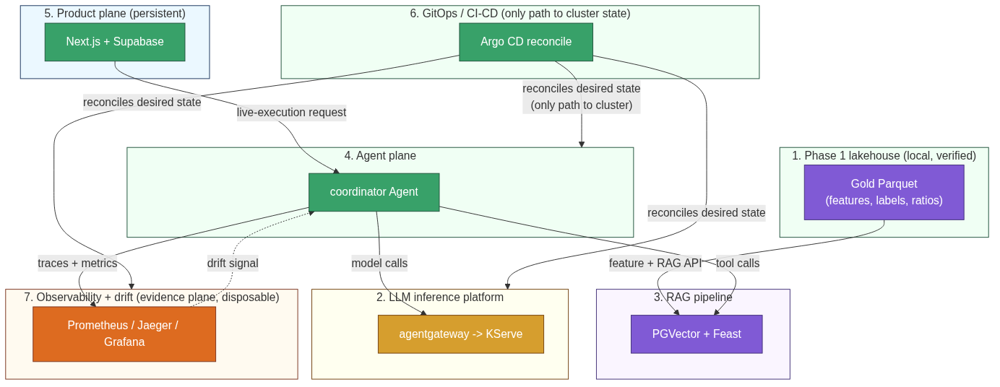
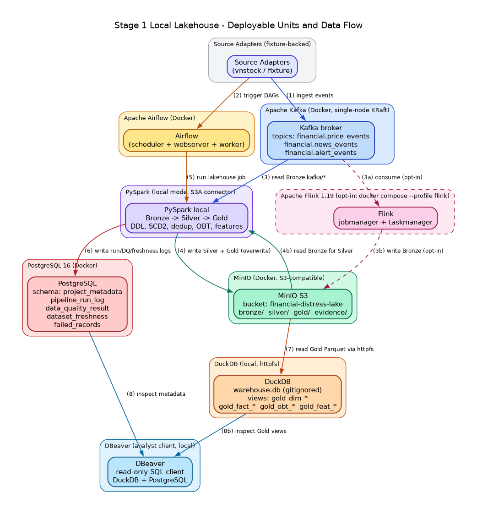

# System Architecture

This document describes the complete system: the verified local-first lakehouse,
the persistent product plane, and the disposable GKE evidence plane. The data
and AI layers are additive; they read existing outputs and do not rename,
remove, or change any lakehouse DAG or storage contract.

## Architecture boundaries

| Boundary | Owner | Runtime | Purpose |
|---|---|---|---|
| Lakehouse | Source monorepo | Docker Compose: Airflow, Kafka, MinIO, PostgreSQL, Spark, DuckDB, optional Flink | Collect, validate, transform, govern, and publish Bronze/Silver/Gold data |
| Product plane | Source monorepo + Supabase | Next.js app, Supabase Auth/Postgres/RLS, outbox/evidence-session state | Persistent analyst, report, registry, chat, and evidence-session UX |
| Evidence plane | `financial-distress-gitops` | GKE Standard, Argo CD, NGINX, agentgateway, kagent, MCP, KServe/Knative, telemetry | Disposable live LLM/agent execution and rubric evidence |

The source monorepo owns code, contracts, tests, product migrations, and
canonical coursework evidence. The private GitOps repository owns Terraform,
Helm values, Argo applications, image digests, cluster policies, and desired
state for the evidence plane.

## Diagram index (documentation overhaul, Phase 3)

Two-level diagram set: one small Mermaid diagram per subsystem, embedded in
its owning narrative doc, plus one composed system diagram for the README
hero. Color legend (fixed, identical across all diagrams — see
`docs/docs-style-contract.md` §7): `edge` = client/ingress boundary,
`service` = running deployable unit, `store` = persisted state, `model` =
ML/LLM artifact or serving endpoint, `result` = observability/output surface.

| # | Subsystem | Source | Owning narrative doc |
|---|---|---|---|
| 1 | Lakehouse | `docs/architecture/subsystem-01-lakehouse.mmd` | `docs/submission/rubric-(mini-coursework)/data_pipeline_orchestration.md` |
| 2 | LLM inference platform | `docs/architecture/subsystem-02-llm-inference-platform.mmd` | `docs/submission/rubric-final-coursework-(final-llm)/llm_inference_platform.md` |
| 3 | RAG pipeline | `docs/architecture/subsystem-03-rag-pipeline.mmd` | `docs/submission/rubric-final-coursework-(final-llm)/rag.md` |
| 4 | Agent plane | `docs/architecture/subsystem-04-agent-plane.mmd` | `docs/submission/rubric-final-coursework-(final-llm)/coordinator_agent.md` |
| 5 | Product plane | `docs/architecture/subsystem-05-product-plane.mmd` | `docs/submission/rubric-final-coursework-(final-llm)/web_api_user_data.md` |
| 6 | GitOps / CI-CD | `docs/architecture/subsystem-06-gitops-cicd.mmd` | `docs/submission/rubric-final-coursework-(final-llm)/ci_cd.md` |
| 7 | Observability + drift | `docs/architecture/subsystem-07-observability-drift.mmd` | `docs/submission/rubric-final-coursework-(final-llm)/observability.md` |

Composed system diagram (README hero):



Source: `docs/architecture/system-overview.mmd`. Regenerate with:

```bash
PUPPETEER_EXECUTABLE_PATH=/usr/bin/google-chrome-stable \
  npx -y @mermaid-js/mermaid-cli \
  -i docs/architecture/system-overview.mmd \
  -o docs/pngs/system_architecture_overview.png -b white -w 1400
```

**Hero image decision:** `images/architecture/architecture-stage-1.png` is
**not retired** — `docs/mini_coursework.md` (the platform spec, source-of-truth,
line-cap exempt) names that exact path as a required deliverable artifact, so
it stays untouched. `docs/pngs/system_architecture_overview.png` is the
*additional* composed lakehouse+LLM hero used by the reviewer-facing README and
narrative docs. The two do not compete: `architecture-stage-1.png` answers the
lakehouse specification's own diagram requirement; `system_architecture_overview.png`
answers this plan's cross-subsystem reviewer view.
`images/architecture/system_deployment_diagram.png` (DOT-rendered) remains the
detailed lakehouse-only deployment view referenced below.

## Verified local lakehouse



The local path is:

```text
source collectors -> Kafka -> Bronze/MinIO -> Silver/Gold/Spark
       |                                      |
       +-> PostgreSQL metadata/DQ             +-> DuckDB/DBeaver inspection
```

- Airflow owns orchestration, retries, validation gates, and publication order.
- Spark owns bounded Bronze-to-Silver/Gold and offline feature computation.
- Flink owns event-time streaming windows, late routing, and TTL deduplication
  only when the `flink` profile and `ENABLE_FLINK=1` are enabled.
- MinIO is the durable local lakehouse boundary; PostgreSQL stores operational
  metadata and DQ results.
- DuckDB/DBeaver is a reviewer inspection surface, not a production serving
  layer.

## Accepted LLM evidence system

The accepted submission is the 60-row / 100-point LLM track. The 57-row ML
track is deferred and remains visible as `design_only` in the rubric matrix.
The current evidence plane is Terraform-provisioned GKE Standard in
`asia-southeast1-b`, reconciled by Argo CD from the separate private control
repository. AWS/EKS, Istio, Envoy Gateway/AI Gateway, ECK/Kibana, Vault, and
Kustomize are not part of the current serving path; ADR-010 is the source of
truth for those decisions.

The repository now contains a LangGraph coordinator pilot selected by
`AGENT_ORCHESTRATION_BACKEND=langgraph`; the default remains the legacy
coordinator until an approved provider endpoint, parity run and clean cutover
are proven. The repository also contains a Jenkins/JCasC delivery contract,
but no live controller proof is claimed.

### Deployable units

| Area | Units | Responsibility |
|---|---|---|
| Edge | F5 NGINX Ingress OSS, cert-manager | TLS and the only external entry point |
| Product | Next.js, Supabase Auth/Postgres/RLS | Persistent authenticated UX and report/session state |
| Agents | kagent CRDs, coordinator, feature agent, drift agent | Restricted orchestration and specialist execution |
| Tool plane | feature-MCP, drift-MCP, feature/RAG API, drift API | Governed retrieval and real-time drift tools |
| Model path | agentgateway, kagent `ModelConfig`, KServe/Knative CPU model server | OpenAI-compatible model routing and inference |
| Data services | Redis, PostgreSQL/PGVector, MinIO, Feast definitions | Online features, vectors, offline artifacts, and versioned manifests |
| Telemetry | OpenTelemetry, Jaeger, Prometheus, Grafana, Loki | Traces, metrics, dashboards, and redaction-safe logs |
| Delivery | GitHub Actions/Jenkins contract, container registry, GitOps PR, Argo CD | Test, scan, sign, promote digest, and reconcile desired state; live Jenkins controller proof remains pending |

### Eight runtime and delivery flows

1. **Analyst:** the authenticated Next.js product calls the declared edge and
   stores durable user/report/session state in Supabase.
2. **Lakehouse data:** collectors publish source events, Airflow/Spark build the
   local lakehouse, and quality/lineage records accompany the Gold outputs.
3. **RAG and governance:** source documents are normalized, chunked, embedded,
   versioned, and stored with governance metadata in the approved feature/RAG
   stores.
4. **Agent + RAG:** the coordinator calls feature and drift specialists;
   specialists reach MCP tools through the declared routes. When the LangGraph
   pilot is selected, the graph preserves the same coordinator response and
   citation guard; provider model routing still follows
   `ModelConfig -> agentgateway -> KServe/Knative` in the target evidence plane.
5. **Evidence session:** the product writes a session request/outbox record,
   the worker tracks the disposable plane state, and the UI renders the
   honest state machine instead of implying that GKE is always available.
6. **CI/GitOps:** source CI tests/builds/scans/signs an immutable image digest;
   the Jenkins repository contract or existing source CI opens a digest-only
   GitOps change; Argo CD reconciles only the merged desired revision.
7. **Observability:** agents and tools emit redaction-safe traces and metrics
   through OpenTelemetry to Jaeger, Prometheus/Grafana, and Loki.
8. **Teardown:** the operator hibernates or tears down the evidence plane after
   capture, preserves only approved evidence/artifacts, and performs the final
   two-repository freeze audit before submission.

## Security and ownership boundaries

- NGINX is the only external entry point; internal services remain `ClusterIP`
  and are protected by default-deny NetworkPolicies.
- Agents run in the restricted `agents-sandbox` namespace with tokenless
  ServiceAccounts, read-only roots, and an explicit egress allow-list.
- Secrets are delivered through the configured secret mechanism and sealed
  deployment state; plaintext credentials do not belong in source or docs.
- The lakehouse writes to `ops`; the platform metadata uses its own schema
  boundary. No component is allowed to mutate the platform evidence.

## Verification state

Historical live verification on **2026-08-13** recorded 13/13 Argo
applications as `Synced` and `Healthy`, established kagent CRDs with 10
`Ready` agents, a successful MCP registration, model warm-up, coordinator HTTP
200 with feature and drift citations, healthy Prometheus targets, and
discoverable Jaeger services. That snapshot is historical, not current-state
proof.

Current local evidence adds real VCI/KBS adapter observations, Spark value
parity, disposable Feast vintage identity, a LangGraph pilot, and digest-only
Jenkins delivery contracts. Current blockers are a fresh cluster materialization,
approved live model-provider access, a live Jenkins controller, protected
HTTPS/edge proof, and the complete current evidence-package freeze.

## Related source-of-truth documents

- [Accepted coursework](coursework.md)
- [Platform architecture and cost envelope](platform/architecture.md)
- [Platform ADR-010](platform/adr/adr-010-llm-only-scope-and-platform-simplification.md)
- [Repository ownership map](architecture/repository-map.md)
- [Submission reviewer index](submission/README.md)
