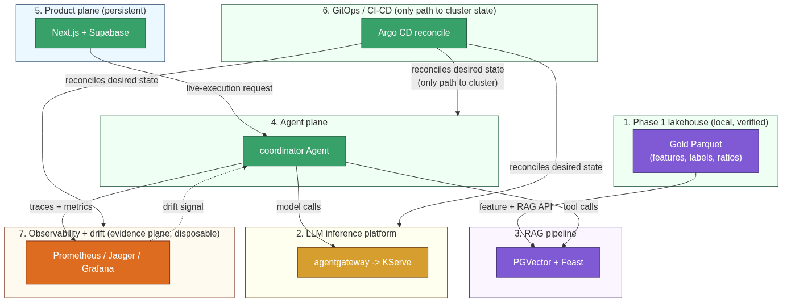
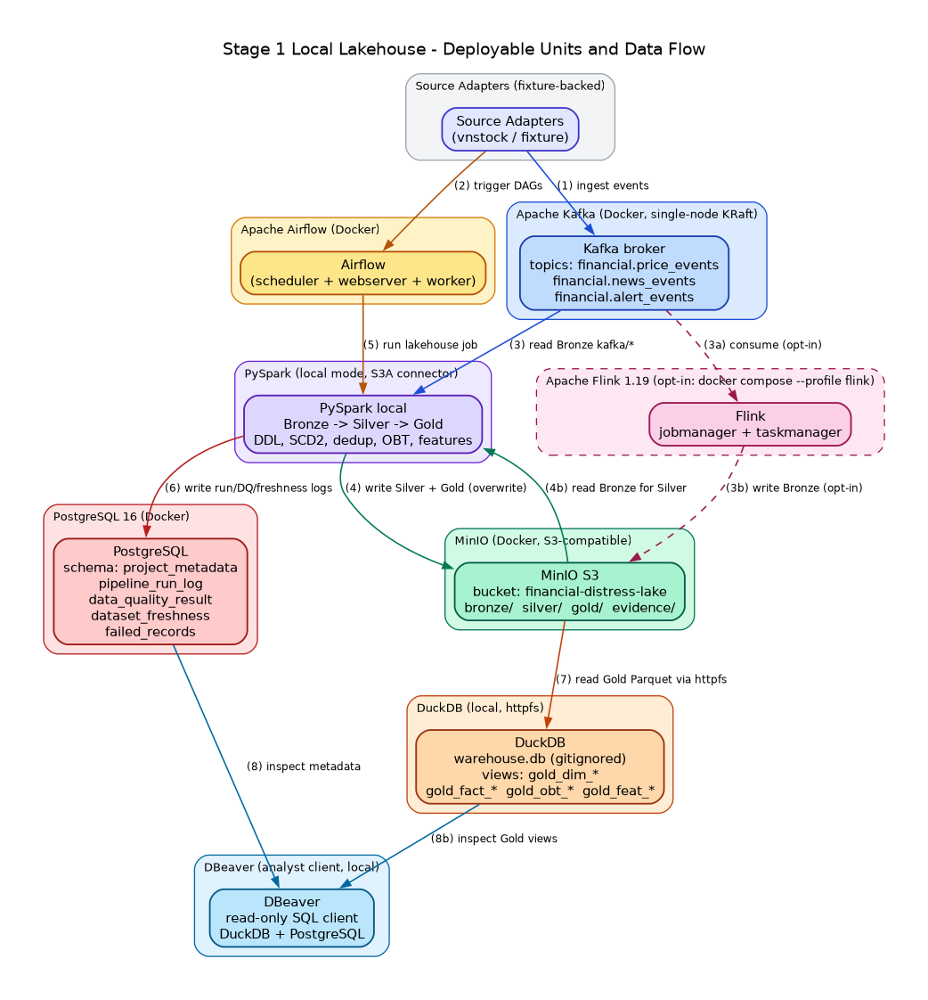

# System Architecture

The local-first lakehouse is the data foundation. The platform adds a persistent
product and on-demand evidence execution without changing the lakehouse DAG or
storage contracts. This source checkout does not select a deployment provider.

## Architecture boundaries

| Boundary | Authority |
|---|---|
| Local lakehouse | [Docker Compose](../docker-compose.yml), [lakehouse spec](mini_coursework.md), and [current data contract](../AGENTS.md#current-contract-v1--what-the-code-actually-does-today) |
| Persistent product | [Web workspace](../apps/web/), [product contract](platform/product.md), and [Supabase migrations](../supabase/migrations/) |
| Live execution | [Configured platform runtime](operator-runbook.md#phase-2-runtime-setup), managed by the external deployment owner |
| Image handoff and promotion | [Source CI](../.github/workflows/phase2-ci.yaml) hands off signed immutable images; rollout and rollback are external |

The persistent product must remain useful when live evidence services are
unavailable. Hosting is a deployment decision, not a product dependency:
the external owner supplies compatible services through explicit endpoints
and is responsible for their readiness. [Handoff criteria](operator-runbook.md#external-deployment-handoff)
and [repository ownership](architecture/repository-map.md) identify where to
make that decision.

## Coursework diagram index

The composed diagram and subsystem views preserve the coursework topology,
including the captured GKE/GitOps deployment. They do not prescribe a
provider for this source checkout. Color legend (see the
[diagram rule](docs-style-contract.md#7-diagram-rule)): `edge` = client/ingress boundary,
`service` = running deployable unit, `store` = persisted state, `model` =
ML/LLM artifact or serving endpoint, `result` = observability/output surface.

| # | Subsystem | Source | Owning narrative doc |
|---|---|---|---|
| 1 | the platform lakehouse | `docs/architecture/subsystem-01-lakehouse.mmd` | `docs/submission/rubric-(mini-coursework)/data_pipeline_orchestration.md` |
| 2 | LLM inference platform | `docs/architecture/subsystem-02-llm-inference-platform.mmd` | `docs/submission/rubric-final-coursework-(final-llm)/llm_inference_platform.md` |
| 3 | RAG pipeline | `docs/architecture/subsystem-03-rag-pipeline.mmd` | `docs/submission/rubric-final-coursework-(final-llm)/rag.md` |
| 4 | Agent plane | `docs/architecture/subsystem-04-agent-plane.mmd` | `docs/submission/rubric-final-coursework-(final-llm)/coordinator_agent.md` |
| 5 | Product plane | `docs/architecture/subsystem-05-product-plane.mmd` | `docs/submission/rubric-final-coursework-(final-llm)/web_api_user_data.md` |
| 6 | GitOps / CI-CD | `docs/architecture/subsystem-06-gitops-cicd.mmd` | `docs/submission/rubric-final-coursework-(final-llm)/ci_cd.md` |
| 7 | Observability + drift | `docs/architecture/subsystem-07-observability-drift.mmd` | `docs/submission/rubric-final-coursework-(final-llm)/observability.md` |

Composed system diagram (README hero):



Source: `docs/architecture/system-overview.mmd`. Regenerate with:

```bash
PUPPETEER_EXECUTABLE_PATH=/usr/bin/google-chrome-stable \
  npx -y @mermaid-js/mermaid-cli \
  -i docs/architecture/system-overview.mmd \
  -o docs/pngs/system_architecture_overview.png -b white -w 1400
```

Keep the [spec-pinned lakehouse image](../images/architecture/architecture-stage-1.png)
for the [mini-coursework deliverable](mini_coursework.md). The composed hero is
the cross-subsystem coursework view; the DOT-rendered image below is the
local lakehouse view.

## Local lakehouse



Use the [local runbook](operator-runbook.md#local-setup) and [naming convention](operator-runbook.md#naming-convention)
for current lakehouse setup and storage boundaries.

## Runtime trust and coursework evidence

Live evidence must come from the configured runtime, not from fixture data,
an old receipt, or an assumption that the coursework cluster is reachable.
Keep credentials and provisioning out of source and docs. Preserve the
lakehouse metadata and evidence boundary when adding a platform runtime.

The GKE topology and source/GitOps revisions are [historical coursework
evidence](operator-runbook.md#historical-phase-2-evidence), not proof of the
identity, readiness, or provenance of a runtime chosen now. The
[coursework architecture](platform/architecture.md) owns the two-plane design,
deployment flows and verification snapshot; the [submission decision](platform/adr/adr-010-llm-only-scope-and-platform-simplification.md)
owns the LLM scope and the deferred ML track.

## Related source-of-truth documents

- [Runtime setup and verification](operator-runbook.md#phase-2-runtime-setup)
- [Repository ownership map](architecture/repository-map.md)
- [Coursework scope](coursework.md) and [submission reviewer index](submission/README.md)
